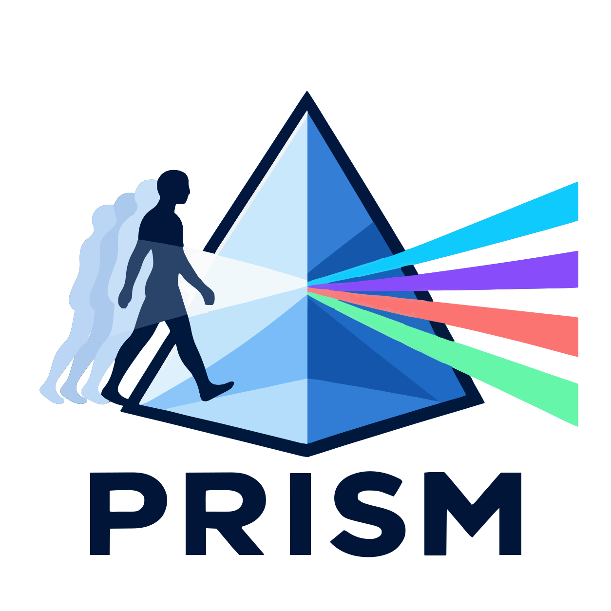

<p align="center">
  
</p>

<p align="center">
  <strong>Interpretable measurement of movement from tracked-person video</strong>
</p>

A behavior label tells us what movement occurred. PRISM describes how that movement was expressed through four complementary measurements:

| Measurement | What it describes |
| --- | --- |
| **Intensity** | How strongly the person moves relative to a torso reference |
| **Extent** | How much the tracked silhouette varies over the bout |
| **Frequency** | How quickly the movement repeats, in Hz |
| **Periodicity score (PS)** | How clearly the motion expresses a dominant repeating cycle |

Duration and inter-bout interval provide temporal context. PRISM measures already identified bouts and connects profiles to illustrative movement examples.

The implementation uses tracked person masks and DIS optical flow. Extent comes from masks; intensity, frequency, and PS come from flow.

## Installation

Use **Python 3.11 or 3.12**, then run from the repository root:

```bash
python3.12 -m venv .venv
source .venv/bin/activate
python -m pip install --upgrade pip
python -m pip install -e '.[plotting]'
```

## Documentation

- [Measurements](docs/measurements.md): definitions, units, PS interpretation, and availability.
- [Reproduction](docs/REPRODUCE.md): setup, required inputs, commands, and outputs for the paper's experiments.

Synthetic experiments use the `paper` extra. Pose inference uses `pose`, and DAM4SAM tracking runs in its own environment. Participant recordings, checkpoints, and saved experiment results are not bundled.

## License

Copyright (c) 2026 Austin MBaye.

This project is licensed under the [PolyForm Noncommercial License 1.0.0](LICENSE).

Noncommercial use, including academic research, personal study, and experimentation, is permitted subject to the license terms.

Commercial use requires separate written permission from the copyright holder.
