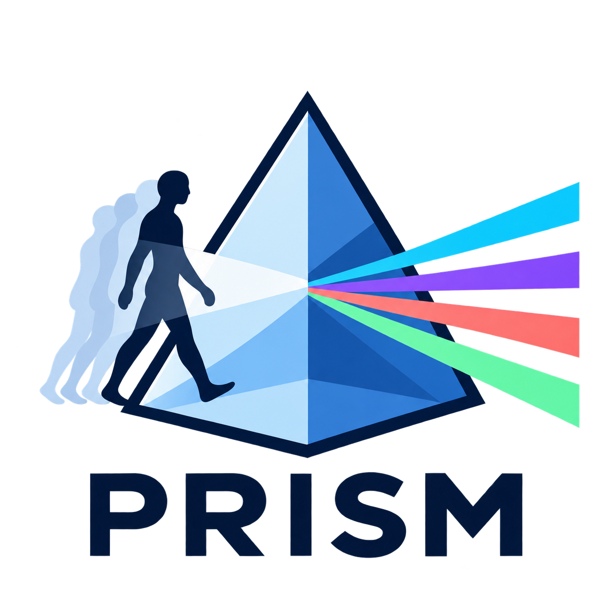

<p align="center">
  
</p>

<p align="center">
  <strong>Interpretable measurement of movement from tracked-person video</strong>
</p>

A behavior label tells us what movement occurred. PRISM describes how that movement was expressed through four complementary measurements:

| Measurement | What it describes |
| --- | --- |
| **Intensity** | How strongly the person moves relative to a torso reference |
| **Extent** | How much the tracked silhouette varies over the bout |
| **Frequency** | How quickly the movement repeats, in Hz |
| **Periodicity score (PS)** | How clearly the motion expresses a dominant repeating cycle |

Duration and inter-bout interval provide temporal context. PRISM measures already identified bouts; the package includes controlled experiments and profile-conditioned movement examples alongside the real-video pipeline.

The implementation uses tracked person masks and DIS optical flow. Extent comes from masks; intensity, frequency, and PS come from flow. The contribution is the measurement framework, and changing the tracker or flow estimator requires checking how the measurements change.

## Install

Use **Python 3.11 or 3.12**. From the repository root:

```bash
python3.12 -m venv .venv
source .venv/bin/activate
python -m pip install --upgrade pip
python -m pip install -e '.[plotting]'
```

For the synthetic experiments and exemplar training, install `.[paper]`. Pose inference uses `.[pose]`. DAM4SAM tracking runs in its own environment. See [installation](docs/INSTALLATION.md) for the available extras and external dependencies.

## Measure prepared bouts

Starting from bout tracks prepared with the [real-video workflow](docs/REAL_VIDEO.md):

```bash
prism-flow --runs-root prism_bouts --episodes-root annotated_runs/episode_runs --backend dis --camera-correction ransac_similarity --region-mode flow_consistent
prism-topology --runs-root prism_bouts --d 23 --n-points 300 --min-period-sec 0.40 --max-period-sec 5.0 --min-cycles 0 --minimum-extent-frames 2
prism-assemble --runs-root prism_bouts --output prism_bouts/analysis.csv
```

The table contains the four measurements, period, torso translation, timing, and quality information. Check availability and frequency eligibility before analysis. 

## Documentation

- [Documentation guide](docs/README.md)
- [Measurement definitions and PS interpretation](docs/MEASUREMENTS.md)
- [Real-video inputs, extraction, and case studies](docs/REAL_VIDEO.md)
- [Controlled experiments and paper reproduction](docs/REPRODUCE.md)
- [Pose agreement and quality audits](docs/POSE.md)
- [Movement examples](docs/EXEMPLARS.md) and the [training-library experiment](docs/EXEMPLAR_SAMPLE_SIZE.md)
- [Paper coverage](docs/PAPER_COVERAGE.md) and [known limits](docs/KNOWN_LIMITS.md)
