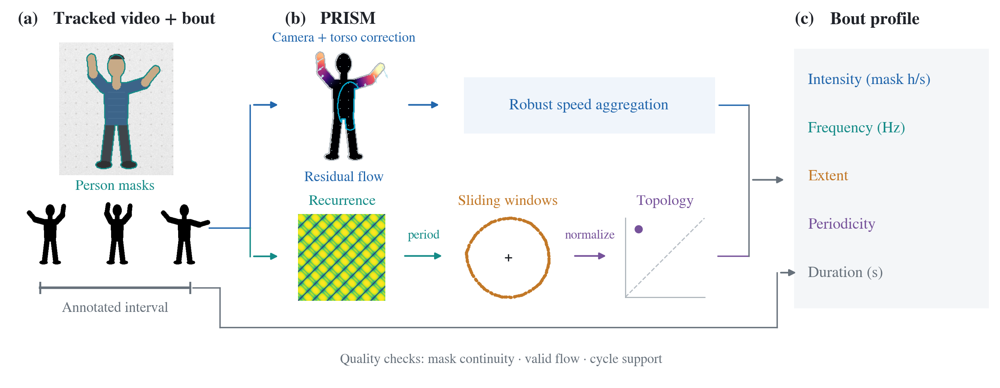

# PRISM

PRISM decomposes tracked-person video mask movement into intensity, spatial extent, frequency, periodic organization, and duration.

<p align="center">
  
</p>

The repository has two separate layers:

1. `prism/` is the production analysis used on real SMM videos.
2. `prism/validation/skeleton_lab/` runs controlled synthetic validation with Skeleton Lab, but calls the same production measurement functions.

Skeleton Lab is a validation dependency.

## Installation

```bash
python3.11 -m venv .venv
source .venv/bin/activate
python -m pip install --upgrade pip
python -m pip install -e ".[topology,stats,dev]"
```

Install the controlled validation environment only when reproducing the synthetic experiments:

```bash
python -m pip install -e ".[validation,dev]"
```

DAM4SAM and its checkpoint remain external because they require their own CUDA environment.

## Measurements

| Coordinate | Primary estimator | Units |
| --- | --- | --- |
| Intensity | camera-corrected, torso-centered masked DIS flow p75 | body heights/s |
| Extent | RMS radius of the unnormalized sliding-window point cloud | mask-distance units |
| Frequency | interpolated lagged self-similarity spectrum | Hz |
| Periodicity | birth-weighted dominant H1 loop minus the second-loop penalty | unitless |
| Duration | annotated onset-to-offset interval | s |

Welch frequency is retained as a benchmark comparator, not the primary reported frequency estimator.

For finite H1 classes ordered by decreasing persistence `m_i = d_i - b_i`, periodicity is

$$
PS = exp(-b1 / 2)\frac{m1}{\sqrt{3}} - exp(-b2 / 2)\frac{m2}{\sqrt{3}}
$$

## Real-video workflow

```bash
# 1. Full-video tracking (CUDA/DAM4SAM environment)
python -m prism.run_dam4sam_batch --help

# 2. Restrict the full-video tracks to annotated bouts
python -m prism.prepare_dam4sam_bouts \
  --tracks-root "results" \
  --episodes-root annotated_runs/episode_runs \
  --output-root prism_bouts


# 3. Torso-centered masked optical-flow intensity
prism-flow \
  --runs-root prism_bouts \
  --episodes-root annotated_runs/episode_runs \
  --camera-correction ransac_similarity \
  --region-mode flow_consistent \
  --save-videos
  --force

# 4. Lagged-SSM frequency, orbit-radius extent, and SW1PerS periodicity
prism-topology \
  --runs-root prism_bouts \
  --frequency-method lagged_ssm \
  --d 23 \
  --n-points 300 \
  --min-period-sec 0.40 \
  --max-period-sec 5.0 \
  --min-cycles 2.5 \
  --force

# 5. Canonical bout-level table
prism-assemble \
  --runs-root prism_bouts \
  --output prism_bouts/analysis.csv
```

## Skeleton Lab validation

Run this from the PRISM repository root after installing the `validation` extra. The scripts import Skeleton Lab as a dependency and save all generated data below `output/`.

```bash
python scripts/generate_skeleton_lab_benchmark.py \
  --output-root output/prism_benchmark

python scripts/run_skeleton_lab_benchmark.py \
  --manifest output/prism_benchmark/benchmark_manifest.csv \
  --output output/prism_benchmark/results.csv \
  --camera-correction synthetic

python scripts/summarize_skeleton_lab_benchmark.py \
  --input output/prism_benchmark/results.csv \
  --out output/prism_benchmark/summary
```

## Multiview 3D validation

The multiview benchmark is included under `prism/validation/multiview/`. It compares exact Skeleton Lab world trajectories with calibrated four-camera 3D
reconstruction, an informative clear view, random views, and an unfavorable partially occluded view. 

Export trajectories from the same Skeleton Lab bundles used above. Current bundles are read directly; older bundles without a saved world trajectory are deterministically regenerated from their saved `spec.json`.

```bash
python scripts/export_skeleton_lab_3d.py \
  --bundles-root output/prism_benchmark/bundles \
  --output-root output/prism_multiview/trajectories

python scripts/run_3d_noninferiority.py \
  --input output/prism_multiview/trajectories \
  --output output/prism_multiview/noninferiority_rows.csv \
  --summary-root output/prism_multiview/noninferiority \
  --random-views 20 \
  --seed 20260930
```

## Mask-aligned pose agreement

Pose is inferred only inside crops derived from the frozen DAM4SAM masks. Pose motion is evaluated on the intersection of pose-valid pairs and the exact frame pairs retained by the frozen optical-flow analysis. Both modalities use the same mask-height and frame-time normalization. The three prespecified comparisons are total motion versus total flow, articulated pose motion versus torso-corrected flow, and pose torso translation versus flow torso translation.

```bash
python scripts/run_mask_aligned_pose_baseline.py \
  --features prism_bouts/analysis.csv \
  --runs-root prism_bouts \
  --output-root prism_pose_validation \
  --bootstrap-replicates 2000 \
  --seed 20260930
```

The output `pose_agreement_correlations.csv` contains pooled Spearman, behavior-specific Spearman, and within-participant/behavior rank associations with participant-clustered percentile confidence intervals. The settings file records the exact flow columns used in each comparison.

## Tests

```bash
python -m pytest -q
```

The tests check the scientific contract: body-height normalization, torso translation removal, lagged-SSM frequency recovery, and the definition of the orbit radius and periodicity score.


## Repository layout

```text
PRISM/
├── prism/                         # production package
│   ├── optical_flow.py
│   ├── plotting/                 
│   ├── topology/
│   └── validation/
│       ├── skeleton_lab/          # 2D synthetic benchmark
│       ├── multiview/             # calibrated 2D/3D benchmark
│       └── pose_baseline/         # mask-aligned real-video baseline
├── scripts/                       # reproducible benchmark entry points
├── examples/                      # benchmark configurations
├── tests/                         # scientific and integration tests
├── docs/                          # methods and reproducibility notes
└── pyproject.toml
```
